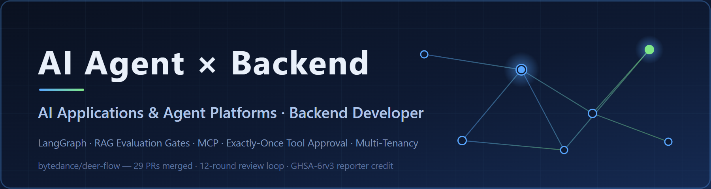

# Hi, I'm 杜凯峰 👋

**AI 应用工程师（Agent 方向）· 全栈开发 · @xiaodu55**

<i>让 AI Agent 在长任务、多渠道与凭据边界上不假死、不丢消息、不泄漏</i>

  <a href="https://xiaodu55.github.io">Site</a> · <a href="https://github.com/xiaodu55">GitHub</a> · <a href="mailto:kfeng.du@outlook.com">Email</a>

## 📊 By the Numbers 数据速览

| Merged PRs | Upstream projects | Own repos | Followers |
| :---: | :---: | :---: | :---: |
| **45** | **10** | **2** | **10** |

<i>统计口径：GitHub 公开接口抓取，作者维度已合并 PR 总数 / 有合并记录的上游仓库数 / 非 fork 公开仓库数（账号公开仓库 27 个含 fork）/ 关注者数 · 截至 2026-11-02</i>

## 🚀 Selected Contributions 代表贡献

| Upstream project | PRs merged | What I did |
| :--- | :---: | :--- |
| [bytedance/deer-flow](https://github.com/bytedance/deer-flow) | **29** | 沙箱与执行链路修复：预热获取按事件状态分类而非粗粒度并发、修复沙箱与 read_file 的 Windows 主机失败、让输出捕获的 POSIX 专属用例在 Windows 上正确跳过 |
| [helsome/folio](https://github.com/helsome/folio) | **6** | 自动化与解析层收紧：必填字段对 null/布尔/数组一律 fail-closed、无实质变化不再误判、投递失败不再降级整轮运行，补齐 RuleCard 状态展示测试 |
| [alibaba/open-code-review](https://github.com/alibaba/open-code-review) | **2** | 评审视图与 diff 处理：会话对比页改版、未跟踪二进制文件在工作区模式下正确标记为二进制 |
| [axonel/sentinel](https://github.com/axonel/sentinel) | **2** | 接入 Claude Code CLI 后端走向 Tier 1；修复密钥脱敏遗漏 JSON 对象键的问题 |

> 另有 5 个已合并 PR 分布在 dify（session 透传）、hermes-agent（全适配器下线时保持存活）、freeCodeCamp、powercontext、heym。

## 🔭 What I Focus On 专注方向

| Direction | What I work on |
| :--- | :--- |
| Agent 治理与投递可靠性 | 四账本投递状态机、治理三牌（心跳自治 / 污点追踪 / 委托驱动）、Scheduled_task 单事务物化 + 租约 fencing |
| RAG 与评测门禁 | 意图分类 → 查询分解 DAG → 多路召回（RRF）→ 引用溯源；220 用例冻结评测集接入 CI 阻断门禁 |
| 执行安全与跨平台 | PreToolUse 三级审批、容器沙箱、工具来源仲裁（SHA-256 指纹 + fail-closed）、Windows 主机边界修复 |

## 🧰 Projects 项目清单

| Area | Project | Stars | Notes |
| :--- | :--- | :---: | :--- |
| Agent 工作台 | [AgentHarbor](https://github.com/xiaodu55/AgentHarbor) | 0 | 自托管多渠道 AI Agent 工作台：七渠道接入、四账本投递、执行沙箱、记忆治理、治理三牌 |
| Agent 平台 | [HFusionHub](https://github.com/xiaodu55/HFusionHub) | 1 | 多租户 AI Agent 平台：Java + Python 双语言分层、RAG 全链路、工具审批 exactly-once、220 用例评测门禁 |

## 🛠️ Tech Stack 技术栈

          

## 🤝 Community & More 社区与日常

- 45 个已合并上游 PR：deer-flow(29)、folio(6)、open-code-review(2)、sentinel(2)、dify(1)、hermes-agent(1)、freeCodeCamp(1)、powercontext(1)、heym(1)、HFusionHub(1)
- 个人博客：[掘金 · HFusion](https://juejin.cn/user/1335237353931068)：心跳五次排雷、fail-open 还是 fail-closed、RAG 评测三轨轨道、120 秒行锁事故复盘、GraphRAG「不立项」的依据

## 📫 Get in Touch 联系我

  <a href="https://github.com/xiaodu55"><strong>GitHub</strong></a> · <a href="mailto:kfeng.du@outlook.com"><strong>Email</strong></a>

<i>欢迎交流 Agent 治理、RAG 评测与开源协作。</i>

